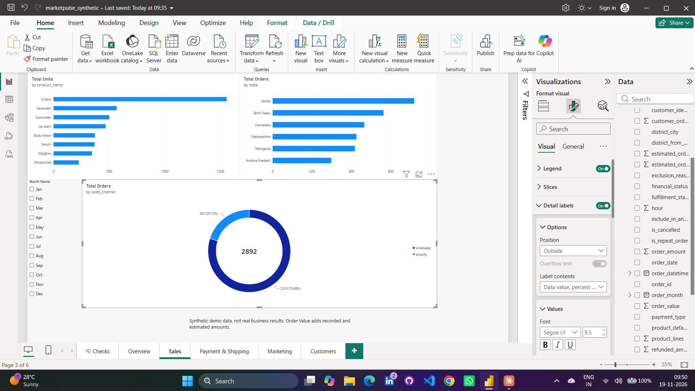
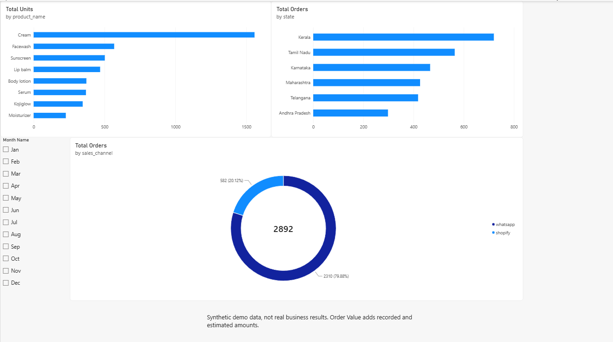
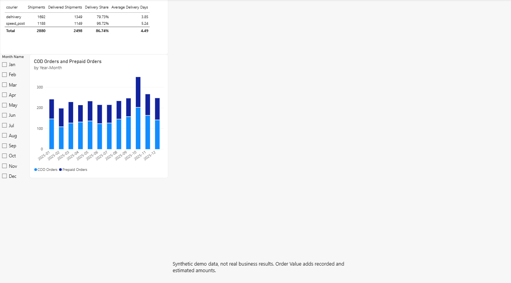
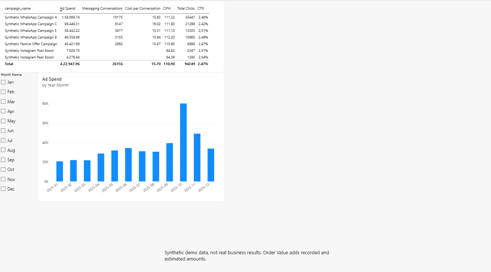
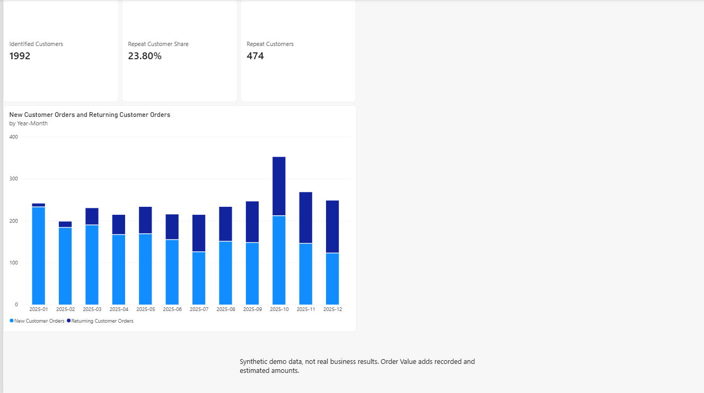

# MarketPulse Analytics

An end-to-end sales and marketing analytics project for a small Indian e-commerce skincare business that takes most of its orders through WhatsApp chats.

It turns raw WhatsApp order messages, Shopify exports and Meta Ads reports into a clean PostgreSQL database, then answers real business questions three independent ways (Python, SQL and Power BI) and checks that all three agree.

> **About the data.** The project is modelled on a real business, but the real customer data is private and never leaves the owner's computer. Everything published here runs on a **synthetic (fake) dataset** with exactly the same structure: about 2,900 orders, 8 products and 8 ad campaigns over one made-up year. No figure in this repository is a real business result.

**Author:** Vyshak Omanakuttan · [LinkedIn](https://www.linkedin.com/in/vyshak-omanakuttan/)



## What this project shows

| Skill | Where to see it |
|---|---|
| **SQL** (window functions, percentiles, self-joins, date spines, correlation) | [`sql/08`–`12`](sql/) — 28 business questions answered in plain PostgreSQL, explained in [`docs/sql_analysis.md`](docs/sql_analysis.md) |
| **Database design** (PostgreSQL) | [`sql/01_create_tables.sql`](sql/01_create_tables.sql), [`sql/07_create_clean_tables.sql`](sql/07_create_clean_tables.sql), [`docs/schema_design.md`](docs/schema_design.md) |
| **Parsing messy real-world text** (Python) | [`python/parse_whatsapp_orders.py`](python/parse_whatsapp_orders.py) — turns free-text WhatsApp order messages into structured rows, flagging anything uncertain instead of guessing |
| **Data cleaning** (pandas) | [`python/clean_data.py`](python/clean_data.py), with every rule explained in [`docs/data_cleaning.md`](docs/data_cleaning.md) |
| **Data quality auditing** | [`python/audit_data_quality.py`](python/audit_data_quality.py) — 66 checks: missing values, duplicates, broken links, outliers |
| **Exploratory analysis** (pandas, NumPy, matplotlib) | [`python/eda.py`](python/eda.py) and the generated [EDA report](reports/eda_synthetic/eda_report.md) |
| **Power BI** (data model, DAX measures, report design) | [`dashboards/`](dashboards/) and [`docs/power_bi_dashboard.md`](docs/power_bi_dashboard.md) |
| **Business insights** | [`docs/business_insights.md`](docs/business_insights.md) — findings turned into recommendations, each with its caveats |
| **Testing** | 263 automated tests (`python -m unittest discover -s python`) |

## How the numbers were checked

The same business questions were answered three separate times — in pandas, in SQL and in Power BI DAX — and the results compared figure by figure. They match: for example, October's 352 orders, a 23.80% repeat-customer rate, and a 59% COD share all agree across all three.

The comparison was not just a formality. It caught real bugs before anything was published:

- **Power BI counted excluded orders.** October showed 354 orders instead of 352, because the first measure did not skip cancelled and excluded rows.
- **Power BI counted customers with no valid orders.** It showed 2,000 identified customers instead of 1,992.
- **Cost per conversation was overstated** (Rs 16.17 instead of Rs 15.70), because spend on campaigns that never start conversations was being divided by the conversation count.
- **A SQL ranking changed between runs.** Two districts with equal order counts swapped places, because the query had no tie-breaker. Caught by running the same file twice and comparing.

## Headline findings (synthetic data)

- **Seasonality:** October is the busiest month (352 orders); weekends and 18:00–20:00 bring the most orders.
- **Customers:** 23.8% of customers order more than once, and the typical gap before a second order is 85 days — a natural point for a reminder message.
- **Payment and delivery:** 59% of orders are cash on delivery. COD parcels (Delhivery) are delivered 80% of the time, against 97% for prepaid (Speed Post) — so a COD amount is money *to collect*, never confirmed revenue.
- **Marketing:** about Rs 15.70 per WhatsApp conversation started. Weekly ad spend and weekly orders move together, but that is a pattern, not proof that ads caused the orders.

Each finding, its caveats and what it would mean on real data are in [`docs/business_insights.md`](docs/business_insights.md).

## The dashboard

Five pages built on the synthetic data, every measure checked against the SQL and Python results.

| Sales | Payment & Shipping |
|---|---|
|  |  |

| Marketing | Customers |
|---|---|
|  |  |

## How the data flows

```
WhatsApp chats ─► parse_whatsapp_orders.py ─┐
Shopify export ─► prepare_shopify_orders.py ─┼─► PostgreSQL raw tables ─► audit + clean_data.py ─► "clean" schema ─┬─► eda.py (Python report)
Meta Ads export ─► prepare_meta_ads.py ──────┘     (sql/01 to 06)          (Python, Pandas)        (sql/07)        ├─► sql/08-12 (SQL analysis)
                                                                                                                    └─► Power BI dashboard
```

The synthetic data is made by [`python/generate_synthetic_data.py`](python/generate_synthetic_data.py) (fixed random seed, so it is reproducible), as described in [`docs/synthetic_data_plan.md`](docs/synthetic_data_plan.md).

## Run it on the synthetic data

Needs Python 3.10+, PostgreSQL and, for the dashboard, Power BI Desktop. From the project folder, with PostgreSQL running and the virtual environment active:

```
python -m pip install -r requirements.txt
python -m unittest discover -s python
python python/audit_data_quality.py --database marketpulse_synthetic --period-start 2025-01-01 --period-end 2025-12-31
python python/clean_data.py --database marketpulse_synthetic
python python/eda.py --database marketpulse_synthetic --output reports/eda_synthetic
psql -U marketpulse_user -d marketpulse_synthetic -h localhost -f sql/08_sales_analysis.sql
```

## Business questions

The project is organised around 30 business questions in five modules, listed with their status in [`docs/business_questions.md`](docs/business_questions.md):

1. Sales Analytics
2. Marketing Analytics
3. Customer Analytics
4. Profitability Analytics
5. Payment and Shipping Analytics

Questions the data cannot answer yet (for example, the true cost of returned COD parcels) are kept on the list and marked "Needs data", not estimated.

## Folder structure

| Folder | Purpose |
|---|---|
| `python` | Import, cleaning, audit and analysis scripts, with their tests |
| `sql` | Database schema (`01`–`07`) and business analysis queries (`08`–`12`) |
| `data/synthetic` | The synthetic (fake) dataset and fake test export files |
| `reports/eda_synthetic` | The generated exploratory analysis report, charts and tables |
| `dashboards` | The Power BI report file and screenshots |
| `docs` | Method, rules and decisions for each phase |

## Data privacy

- The real business data is processed only on the owner's own computer and is never committed. See [`docs/data_privacy.md`](docs/data_privacy.md).
- The synthetic data contains no real names, phone numbers or addresses.
- Estimates are always labelled as estimates, and no advertising attribution is invented.

## Status

Phases 1–7 are complete: data model, importing, cleaning, exploratory analysis, SQL analysis, the Power BI dashboard on synthetic data, and business insights. Still to come: the dashboard on the private data (kept private), and an optional API.
