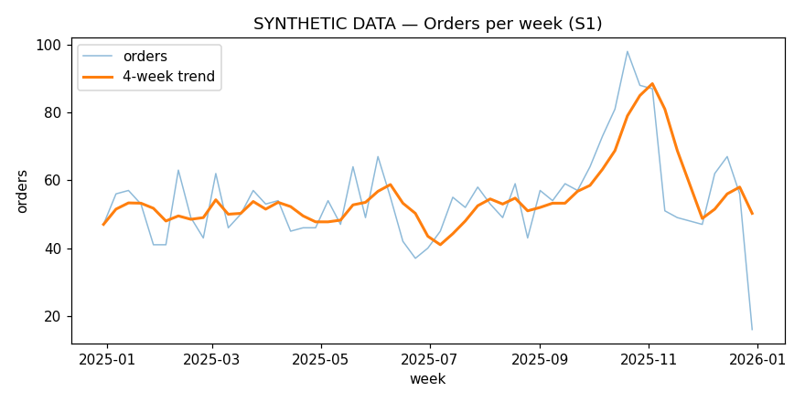
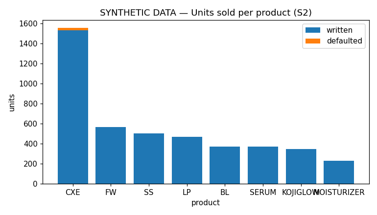
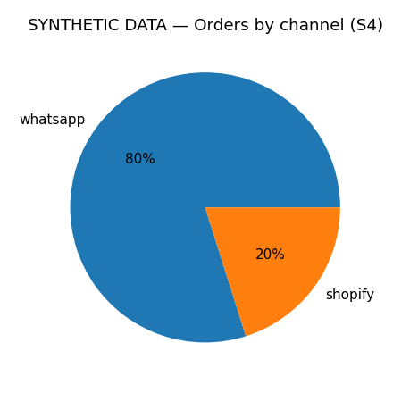
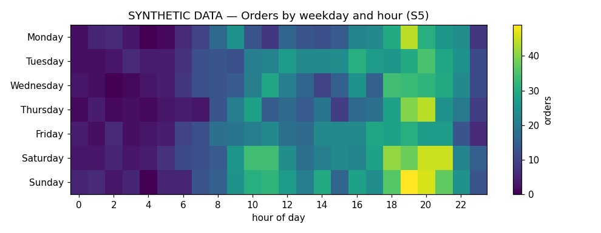
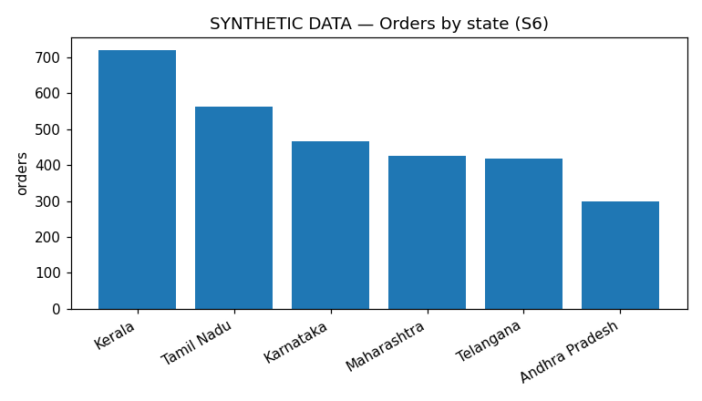
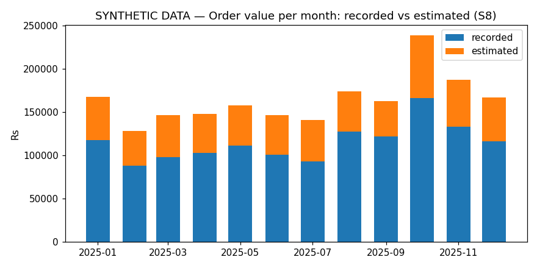
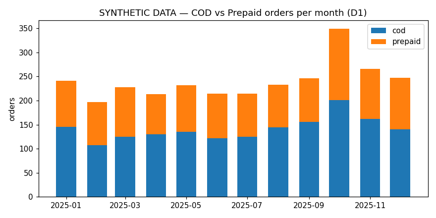
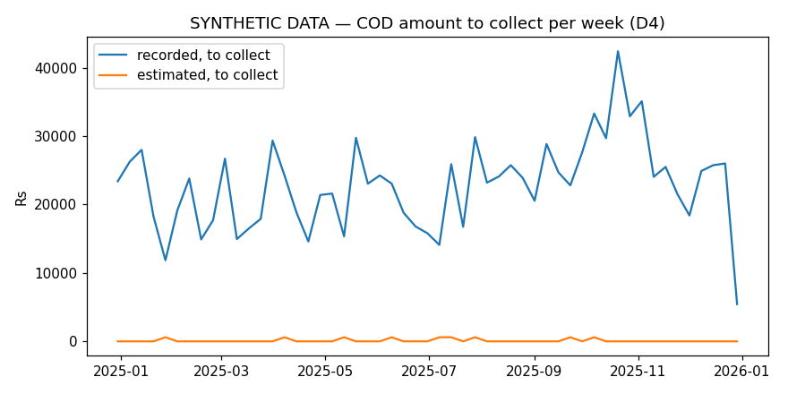
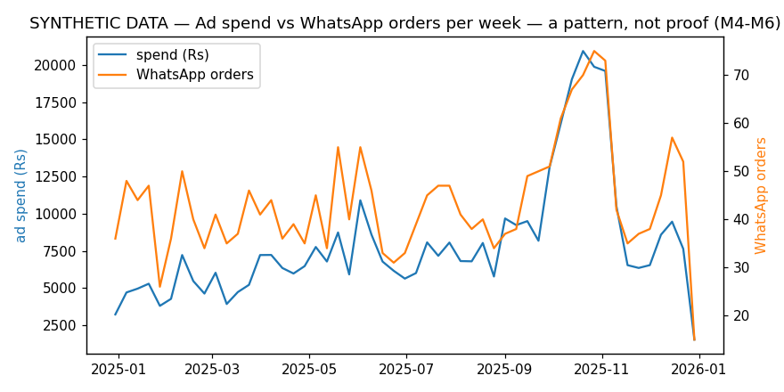

# Exploratory Data Analysis — SYNTHETIC DATA

> **SYNTHETIC DATA.** Every number on this page comes from the fake data generator (`python/generate_synthetic_data.py`). Any pattern shown is a pattern in made-up data, not a real business result.

Only counted orders are used (`include_in_analysis = true`). An amount is labelled as it is: **recorded**, **estimated** or **unknown**. A COD amount is the amount **to collect**, not confirmed revenue. See `docs/data_cleaning.md` and `docs/eda.md`.

## Sales

### S1: Orders per month

Orders ranged from 198 to 352 per month, peaking in October 2025 with 352 orders.

| order_month | orders |
|---|---|
| 2025-01-01 | 241 |
| 2025-02-01 | 198 |
| 2025-03-01 | 230 |
| 2025-04-01 | 214 |
| 2025-05-01 | 233 |
| 2025-06-01 | 215 |
| 2025-07-01 | 214 |
| 2025-08-01 | 233 |
| 2025-09-01 | 246 |
| 2025-10-01 | 352 |
| 2025-11-01 | 268 |
| 2025-12-01 | 248 |

### S1: Orders per week, with trend

The busiest week started 20 Oct 2025, with 98 orders (trend at that point: 79 orders per week).

| week_start | orders | trend |
|---|---|---|
| 2024-12-30 | 47 | 47.00 |
| 2025-01-06 | 56 | 51.50 |
| 2025-01-13 | 57 | 53.33 |
| 2025-01-20 | 53 | 53.25 |
| 2025-01-27 | 41 | 51.75 |
| 2025-02-03 | 41 | 48.00 |
| 2025-02-10 | 63 | 49.50 |
| 2025-02-17 | 49 | 48.50 |
| 2025-02-24 | 43 | 49.00 |
| 2025-03-03 | 62 | 54.25 |
| 2025-03-10 | 46 | 50.00 |
| 2025-03-17 | 50 | 50.25 |
| 2025-03-24 | 57 | 53.75 |
| 2025-03-31 | 53 | 51.50 |
| 2025-04-07 | 54 | 53.50 |

_... and 38 more rows (see the matching CSV file)._

### S2: Units sold per product

Cream sold the most units (1,558, 35% of all units). 23 units came from orders with no product line (the owner's default rule).

| product_code | product_name | units_written | units_defaulted | units_total | share_of_units |
|---|---|---|---|---|---|
| CXE | Cream | 1,535 | 23 | 1,558 | 0.35 |
| FW | Facewash | 568 | 0 | 568 | 0.13 |
| SS | Sunscreen | 502 | 0 | 502 | 0.11 |
| LP | Lip balm | 469 | 0 | 469 | 0.11 |
| BL | Body lotion | 372 | 0 | 372 | 0.08 |
| SERUM | Serum | 369 | 0 | 369 | 0.08 |
| KOJIGLOW | Kojiglow | 346 | 0 | 346 | 0.08 |
| MOISTURIZER | Moisturizer | 227 | 0 | 227 | 0.05 |

### S3: Products bought together, top pairs

CXE and FW were bought together most often (165 orders).

| product_a | product_b | orders |
|---|---|---|
| CXE | FW | 165 |
| CXE | SS | 146 |
| CXE | LP | 133 |
| CXE | KOJIGLOW | 104 |
| CXE | SERUM | 99 |
| BL | CXE | 97 |
| CXE | MOISTURIZER | 65 |
| FW | LP | 47 |
| FW | SERUM | 43 |
| FW | SS | 41 |

### S4: Orders by channel

Orders by channel: whatsapp 80%, shopify 20%.

| sales_channel | orders | share |
|---|---|---|
| whatsapp | 2,310 | 0.80 |
| shopify | 582 | 0.20 |

### S5: Orders by weekday and hour

| weekday | 0 | 1 | 2 | 3 | 4 | 5 | 6 | 7 | 8 | 9 | 10 | 11 | 12 | 13 | 14 | 15 | 16 | 17 | 18 | 19 | 20 | 21 | 22 | 23 |
|---|---|---|---|---|---|---|---|---|---|---|---|---|---|---|---|---|---|---|---|---|---|---|---|---|
| Monday | 2 | 5 | 6 | 3 | 0 | 1 | 6 | 10 | 17 | 25 | 13 | 8 | 16 | 13 | 12 | 14 | 22 | 23 | 30 | 44 | 31 | 26 | 24 | 8 |
| Tuesday | 2 | 2 | 3 | 6 | 4 | 4 | 7 | 12 | 13 | 12 | 21 | 22 | 27 | 23 | 23 | 24 | 31 | 27 | 26 | 30 | 35 | 29 | 25 | 11 |
| Wednesday | 3 | 2 | 0 | 1 | 3 | 4 | 8 | 12 | 13 | 14 | 21 | 29 | 21 | 16 | 10 | 15 | 25 | 15 | 34 | 33 | 32 | 30 | 23 | 11 |
| Thursday | 1 | 4 | 1 | 2 | 1 | 3 | 4 | 3 | 13 | 21 | 28 | 14 | 17 | 14 | 19 | 9 | 17 | 18 | 28 | 40 | 44 | 25 | 20 | 9 |
| Friday | 4 | 2 | 6 | 2 | 3 | 4 | 10 | 12 | 18 | 19 | 21 | 23 | 18 | 17 | 23 | 23 | 23 | 29 | 28 | 31 | 27 | 27 | 13 | 6 |
| Saturday | 3 | 3 | 5 | 3 | 4 | 7 | 11 | 12 | 14 | 26 | 34 | 34 | 24 | 18 | 21 | 23 | 22 | 28 | 41 | 38 | 45 | 45 | 22 | 15 |
| Sunday | 5 | 6 | 3 | 5 | 0 | 5 | 5 | 13 | 15 | 25 | 31 | 32 | 27 | 21 | 30 | 16 | 28 | 24 | 36 | 49 | 46 | 37 | 25 | 13 |

### S6: Orders by state

Kerala placed the most orders (720, 25% of the total).

| state | orders | share |
|---|---|---|
| Kerala | 720 | 0.25 |
| Tamil Nadu | 564 | 0.20 |
| Karnataka | 466 | 0.16 |
| Maharashtra | 426 | 0.15 |
| Telangana | 418 | 0.14 |
| Andhra Pradesh | 298 | 0.10 |

### S6: Top districts

Thrissur (Kerala) is the district with the most orders among those shown (160, 6% of all counted orders).

| district_city | state | orders | share |
|---|---|---|---|
| Thrissur | Kerala | 160 | 0.06 |
| Kollam | Kerala | 142 | 0.05 |
| Kozhikode | Kerala | 141 | 0.05 |
| Mumbai | Maharashtra | 141 | 0.05 |
| Ernakulam | Kerala | 138 | 0.05 |
| Thiruvananthapuram | Kerala | 133 | 0.05 |
| Belagavi | Karnataka | 131 | 0.05 |
| Coimbatore | Tamil Nadu | 128 | 0.04 |
| Mysuru | Karnataka | 118 | 0.04 |
| Tiruchirappalli | Tamil Nadu | 115 | 0.04 |
| (unknown) | (all states) | 38 | 0.01 |

### S7: Items and units per order

The median order has 1 product line(s) and 1 unit(s).

| measure | orders | average | median | p25 | p75 | p90 | max |
|---|---|---|---|---|---|---|---|
| product_lines | 2,892 | 1.39 | 1.00 | 1.00 | 2.00 | 2.00 | 3.00 |
| units | 2,892 | 1.53 | 1.00 | 1.00 | 2.00 | 3.00 | 6.00 |

### S8: Order value per month

Total order value: Rs 1,380,350 recorded, Rs 588,700 estimated, and 12 orders with no value at all.

| order_month | recorded_value | estimated_value | orders_recorded | orders_estimated | orders_unknown |
|---|---|---|---|---|---|
| 2025-01-01 | 118,000.00 | 50,200.00 | 164 | 77 | 0 |
| 2025-02-01 | 88,200.00 | 40,200.00 | 128 | 69 | 1 |
| 2025-03-01 | 98,450.00 | 48,550.00 | 147 | 81 | 2 |
| 2025-04-01 | 103,350.00 | 44,700.00 | 145 | 68 | 1 |
| 2025-05-01 | 111,900.00 | 46,250.00 | 150 | 82 | 1 |
| 2025-06-01 | 100,850.00 | 46,150.00 | 139 | 75 | 1 |
| 2025-07-01 | 93,150.00 | 48,200.00 | 135 | 79 | 0 |
| 2025-08-01 | 127,550.00 | 46,800.00 | 167 | 66 | 0 |
| 2025-09-01 | 121,850.00 | 41,150.00 | 177 | 69 | 0 |
| 2025-10-01 | 166,650.00 | 72,400.00 | 235 | 114 | 3 |
| 2025-11-01 | 133,600.00 | 53,900.00 | 188 | 78 | 2 |
| 2025-12-01 | 116,800.00 | 50,200.00 | 165 | 82 | 1 |

## Customers

### C1: Repeat customers

23.8% of known customers ordered more than once (23.4% without possible duplicates).

| version | customers | repeat_customers | repeat_share |
|---|---|---|---|
| all counted orders | 1,992 | 474 | 0.24 |
| without possible duplicates | 1,992 | 467 | 0.23 |

### C2: Days to a second order

Customers who ordered again took a median of 85 days to do so.

| customers_with_a_second_order | average_days | median_days | p25 | p75 | p90 |
|---|---|---|---|---|---|
| 474 | 103.27 | 85.00 | 35.25 | 152.00 | 219.70 |

### C4: New vs returning customers per month

Returning-customer orders went from 9 in January 2025 to 126 in December 2025. Early months of any dataset show few returning customers simply because there has been less time for a second order, not because loyalty is rising.

| order_month | new_customer_orders | returning_customer_orders | unknown_customer_orders |
|---|---|---|---|
| 2025-01-01 | 232 | 9 | 0 |
| 2025-02-01 | 183 | 15 | 0 |
| 2025-03-01 | 189 | 41 | 0 |
| 2025-04-01 | 166 | 48 | 0 |
| 2025-05-01 | 168 | 65 | 0 |
| 2025-06-01 | 154 | 61 | 0 |
| 2025-07-01 | 125 | 89 | 0 |
| 2025-08-01 | 150 | 83 | 0 |
| 2025-09-01 | 147 | 99 | 0 |
| 2025-10-01 | 211 | 141 | 0 |
| 2025-11-01 | 145 | 123 | 0 |
| 2025-12-01 | 122 | 126 | 0 |

### C5: Repeat customers by district

Among districts with enough customers to compare, Mumbai (Maharashtra) has the highest repeat-customer share (31%).

| district_city | state | customers | repeat_customers | repeat_share |
|---|---|---|---|---|
| Mumbai | Maharashtra | 86 | 27 | 0.31 |
| Visakhapatnam | Andhra Pradesh | 45 | 14 | 0.31 |
| Karimnagar | Telangana | 70 | 21 | 0.30 |
| Belagavi | Karnataka | 85 | 25 | 0.29 |
| Hyderabad | Telangana | 66 | 19 | 0.29 |
| Tiruchirappalli | Tamil Nadu | 76 | 21 | 0.28 |
| Kozhikode | Kerala | 94 | 24 | 0.26 |
| Madurai | Tamil Nadu | 75 | 19 | 0.25 |
| Mysuru | Karnataka | 81 | 20 | 0.25 |
| Chittoor | Andhra Pradesh | 49 | 12 | 0.24 |
| Thiruvananthapuram | Kerala | 90 | 22 | 0.24 |
| Chennai | Tamil Nadu | 63 | 15 | 0.24 |
| Thrissur | Kerala | 114 | 27 | 0.24 |
| Warangal | Telangana | 76 | 18 | 0.24 |
| Coimbatore | Tamil Nadu | 90 | 21 | 0.23 |

_... and 11 more rows (see the matching CSV file)._

## Payment and shipping

### D1: COD vs Prepaid per month

Across the period, 59% of orders with a known payment type were COD.

| order_month | cod | prepaid | needs_review | cod_share |
|---|---|---|---|---|
| 2025-01-01 | 145 | 96 | 0 | 0.60 |
| 2025-02-01 | 107 | 90 | 1 | 0.54 |
| 2025-03-01 | 125 | 103 | 2 | 0.55 |
| 2025-04-01 | 130 | 83 | 1 | 0.61 |
| 2025-05-01 | 135 | 97 | 1 | 0.58 |
| 2025-06-01 | 122 | 92 | 1 | 0.57 |
| 2025-07-01 | 125 | 89 | 0 | 0.58 |
| 2025-08-01 | 144 | 89 | 0 | 0.62 |
| 2025-09-01 | 156 | 90 | 0 | 0.63 |
| 2025-10-01 | 201 | 148 | 3 | 0.58 |
| 2025-11-01 | 162 | 104 | 2 | 0.61 |
| 2025-12-01 | 140 | 107 | 1 | 0.57 |

### D2: COD share by state

Among states with enough orders to compare, Telangana leans most towards COD (75%).

| state | orders | cod | prepaid | needs_review | cod_share |
|---|---|---|---|---|---|
| Telangana | 418 | 311 | 106 | 1 | 0.75 |
| Andhra Pradesh | 298 | 220 | 77 | 1 | 0.74 |
| Tamil Nadu | 564 | 318 | 244 | 2 | 0.57 |
| Kerala | 720 | 403 | 313 | 4 | 0.56 |
| Maharashtra | 426 | 233 | 192 | 1 | 0.55 |
| Karnataka | 466 | 207 | 256 | 3 | 0.45 |

### D3: Basket size, COD vs Prepaid

| payment_type | orders | average_product_lines | average_units | median_units |
|---|---|---|---|---|
| cod | 1,692 | 1.39 | 1.53 | 1.00 |
| prepaid | 1,188 | 1.38 | 1.51 | 1.00 |

### D3: Product mix, COD vs Prepaid

| product_code | cod | prepaid |
|---|---|---|
| CXE | 0.35 | 0.36 |
| FW | 0.13 | 0.12 |
| SS | 0.12 | 0.11 |
| LP | 0.11 | 0.10 |
| BL | 0.09 | 0.08 |
| KOJIGLOW | 0.08 | 0.08 |
| SERUM | 0.08 | 0.09 |
| MOISTURIZER | 0.05 | 0.06 |

### D4: COD amount to collect per week

COD orders had Rs 1,209,300 recorded and Rs 5,400 estimated to COLLECT. This is not confirmed revenue: a COD parcel can be returned and never paid for.

| week_start | cod_orders | amount_to_collect | estimated_to_collect | orders_without_value |
|---|---|---|---|---|
| 2024-12-30 | 31 | 23,400.00 | 0.00 | 0 |
| 2025-01-06 | 37 | 26,250.00 | 0.00 | 0 |
| 2025-01-13 | 34 | 28,000.00 | 0.00 | 0 |
| 2025-01-20 | 29 | 18,250.00 | 0.00 | 0 |
| 2025-01-27 | 19 | 11,850.00 | 600.00 | 0 |
| 2025-02-03 | 24 | 19,150.00 | 0.00 | 0 |
| 2025-02-10 | 35 | 23,800.00 | 0.00 | 0 |
| 2025-02-17 | 23 | 14,900.00 | 0.00 | 0 |
| 2025-02-24 | 27 | 17,700.00 | 0.00 | 0 |
| 2025-03-03 | 38 | 26,700.00 | 0.00 | 0 |
| 2025-03-10 | 26 | 14,950.00 | 0.00 | 0 |
| 2025-03-17 | 24 | 16,500.00 | 0.00 | 0 |
| 2025-03-24 | 27 | 17,900.00 | 0.00 | 0 |
| 2025-03-31 | 36 | 29,350.00 | 0.00 | 0 |
| 2025-04-07 | 33 | 24,250.00 | 600.00 | 0 |

_... and 38 more rows (see the matching CSV file)._

### D5: Delivery outcomes

delhivery 80% delivered, 17% returned; speed_post 97% delivered, 2% returned.

| courier | payment_type | shipments | delivered | returned | unknown | delivered_share | returned_share |
|---|---|---|---|---|---|---|---|
| delhivery | cod | 1,692 | 1,349 | 293 | 50 | 0.80 | 0.17 |
| speed_post | prepaid | 1,188 | 1,149 | 23 | 16 | 0.97 | 0.02 |

### D6: Delivery days by courier

delhivery median 4 days; speed_post median 5 days.

| courier | deliveries | average_days | median_days | p90_days |
|---|---|---|---|---|
| delhivery | 1,349 | 3.85 | 4.00 | 6.00 |
| speed_post | 1,149 | 5.24 | 5.00 | 8.00 |

## Marketing

### M1: Ad spend per week

Total ad spend: Rs 422,948 over 53 weeks.

| week_start | amount_spent_inr |
|---|---|
| 2024-12-30 | 3,225.76 |
| 2025-01-06 | 4,702.67 |
| 2025-01-13 | 4,958.38 |
| 2025-01-20 | 5,288.89 |
| 2025-01-27 | 3,801.98 |
| 2025-02-03 | 4,271.04 |
| 2025-02-10 | 7,217.17 |
| 2025-02-17 | 5,467.93 |
| 2025-02-24 | 4,627.66 |
| 2025-03-03 | 6,026.53 |
| 2025-03-10 | 3,926.30 |
| 2025-03-17 | 4,727.46 |
| 2025-03-24 | 5,213.25 |
| 2025-03-31 | 7,216.92 |
| 2025-04-07 | 7,223.58 |

_... and 38 more rows (see the matching CSV file)._

### M2: Cost per messaging conversation

The cheapest messaging campaign cost Rs 15 per conversation.

| campaign_id | campaign_name | amount_spent_inr | conversations | cost_per_conversation |
|---|---|---|---|---|
| 120342538219708160 | Synthetic WhatsApp Campaign E | 58,442.22 | 3,817 | 15.31 |
| 120565139027107224 | Synthetic WhatsApp Campaign A | 159,069.74 | 10,175 | 15.63 |
| 120111629465817546 | Synthetic WhatsApp Campaign B | 49,358.86 | 3,155 | 15.64 |
| 120686143559851115 | Synthetic Festive Offer Campaign | 45,421.69 | 2,862 | 15.87 |
| 120454363002200843 | Synthetic WhatsApp Campaign C | 98,449.31 | 6,147 | 16.02 |

### M3: Weekly CPM and CTR per campaign

Across all campaign-weeks, average CPM was Rs 110 per 1,000 impressions, and average CTR was 2.5%.

| campaign_id | campaign_name | week_start | amount_spent_inr | impressions | cpm | ctr |
|---|---|---|---|---|---|---|
| 120111629465817546 | Synthetic WhatsApp Campaign B | 2024-12-30 | 1,273.49 | 12,185 | 104.51 | 0.02 |
| 120111629465817546 | Synthetic WhatsApp Campaign B | 2025-01-06 | 2,053.66 | 20,841 | 98.54 | 0.02 |
| 120111629465817546 | Synthetic WhatsApp Campaign B | 2025-01-13 | 1,763.46 | 16,628 | 106.05 | 0.03 |
| 120111629465817546 | Synthetic WhatsApp Campaign B | 2025-01-20 | 2,106.19 | 18,791 | 112.09 | 0.02 |
| 120111629465817546 | Synthetic WhatsApp Campaign B | 2025-01-27 | 1,522.81 | 14,165 | 107.51 | 0.02 |
| 120111629465817546 | Synthetic WhatsApp Campaign B | 2025-02-03 | 1,338.54 | 11,029 | 121.37 | 0.02 |
| 120111629465817546 | Synthetic WhatsApp Campaign B | 2025-02-10 | 2,489.18 | 20,852 | 119.37 | 0.02 |
| 120111629465817546 | Synthetic WhatsApp Campaign B | 2025-02-17 | 1,895.20 | 17,662 | 107.30 | 0.03 |
| 120111629465817546 | Synthetic WhatsApp Campaign B | 2025-02-24 | 1,683.82 | 15,141 | 111.21 | 0.03 |
| 120111629465817546 | Synthetic WhatsApp Campaign B | 2025-03-03 | 2,400.24 | 22,582 | 106.29 | 0.02 |
| 120111629465817546 | Synthetic WhatsApp Campaign B | 2025-03-10 | 1,751.58 | 15,344 | 114.15 | 0.02 |
| 120111629465817546 | Synthetic WhatsApp Campaign B | 2025-03-17 | 1,861.40 | 16,801 | 110.79 | 0.03 |
| 120111629465817546 | Synthetic WhatsApp Campaign B | 2025-03-24 | 2,129.19 | 19,088 | 111.55 | 0.02 |
| 120111629465817546 | Synthetic WhatsApp Campaign B | 2025-03-31 | 1,994.04 | 18,770 | 106.24 | 0.03 |
| 120111629465817546 | Synthetic WhatsApp Campaign B | 2025-04-07 | 1,978.78 | 16,173 | 122.35 | 0.03 |

_... and 152 more rows (see the matching CSV file)._

### M4-M6: Ad spend vs WhatsApp orders per week

Weekly ad spend and weekly WhatsApp orders moved together with a correlation of 0.86. This is a PATTERN only, not proof that the spend caused those orders: nothing in this data links one ad to one order.

| week_start | amount_spent_inr | messaging_conversations | whatsapp_orders | spend_per_order | conversations_per_order |
|---|---|---|---|---|---|
| 2024-12-30 | 3,225.76 | 258 | 36 | 89.60 | 7.17 |
| 2025-01-06 | 4,702.67 | 350 | 48 | 97.97 | 7.29 |
| 2025-01-13 | 4,958.38 | 351 | 44 | 112.69 | 7.98 |
| 2025-01-20 | 5,288.89 | 300 | 47 | 112.53 | 6.38 |
| 2025-01-27 | 3,801.98 | 232 | 26 | 146.23 | 8.92 |
| 2025-02-03 | 4,271.04 | 217 | 36 | 118.64 | 6.03 |
| 2025-02-10 | 7,217.17 | 338 | 50 | 144.34 | 6.76 |
| 2025-02-17 | 5,467.93 | 295 | 40 | 136.70 | 7.38 |
| 2025-02-24 | 4,627.66 | 277 | 34 | 136.11 | 8.15 |
| 2025-03-03 | 6,026.53 | 370 | 41 | 146.99 | 9.02 |
| 2025-03-10 | 3,926.30 | 212 | 35 | 112.18 | 6.06 |
| 2025-03-17 | 4,727.46 | 278 | 37 | 127.77 | 7.51 |
| 2025-03-24 | 5,213.25 | 295 | 46 | 113.33 | 6.41 |
| 2025-03-31 | 7,216.92 | 460 | 41 | 176.02 | 11.22 |
| 2025-04-07 | 7,223.58 | 478 | 44 | 164.17 | 10.86 |

_... and 38 more rows (see the matching CSV file)._
